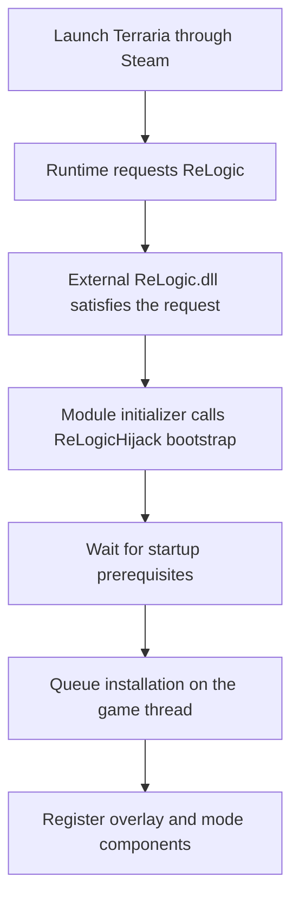

# Technical details

This document describes ReLogicHijack's implementation for Windows Steam Terraria 1.4.5.8. Source links point to the relevant files in this repository.

## Dependency hijacking versus binding redirects

A .NET Framework binding redirect is a configuration rule that substitutes one assembly version for another. ReLogicHijack does not add or edit `Terraria.exe.config` and does not use `<bindingRedirect>`.

Terraria embeds dependencies inside its executable, including the resource `Terraria.Libraries.ReLogic.ReLogic.dll`. Its assembly-resolution fallback can supply that embedded assembly when normal dependency loading fails. An external `ReLogic.dll` beside the executable satisfies the request first, so the embedded fallback is unnecessary for that dependency.

ReLogicHijack supplies such an external assembly, retaining ReLogic's original implementation and adding a module-initializer call into the mod. This is managed assembly or dependency hijacking. It is the Terraria-specific shortcut described in [Chapter 7 of the original article](https://bepis.io/blog/binding-redirects/#chapter-7-optimizations-and-caveats). The related [NRedirect project](https://github.com/BepInEx/NRedirect) implements the broader binding-redirect approach.

The original executable remains unchanged on disk. The loaded dependency and the running client's behaviour are modified. The loader uses Terraria's existing process and application domain. The two demonstration features use existing events, game components, and reflection; they install no method detours or damage/death hooks. Mono.Cecil is used only during the build and is not copied into the game directory.

## Build and startup sequence



1. [`Build.ps1`](../Build.ps1) reads `Terraria.exe` with Mono.Cecil, extracts the original ReLogic assembly for compilation, and compiles the mod as the x86 assembly `ReLogicHijack.dll`.
2. [`GenerateProxy.cs`](../src/GenerateProxy.cs) reads the embedded ReLogic assembly and creates or extends its `<Module>..cctor`. It inserts a call to `ReLogicHijack.Bootstrap.Start()` and writes the result as `ReLogic.dll`. Existing dependency methods remain present. The generator rejects a strong-named ReLogic assembly.
3. The build writes SHA-256 hashes for the executable and the two installable DLLs into `build-manifest.json`.
4. When the runtime initializes the external ReLogic module, its initializer calls the bootstrap. The reference to the bootstrap causes `ReLogicHijack.dll` to be loaded.
5. [`Bootstrap.cs`](../src/Bootstrap.cs) checks that the entry assembly is the Terraria client, guards against repeated initialization, and starts a background worker. It waits for `Terraria.Program.SavePath` to be initialized, adds a short startup delay, and queues `Overlay.Install` through `Main.QueueMainThreadAction`. It times out if startup prerequisites never become available.
6. [`Overlay.Install`](../src/Overlay.cs) registers the two game components and subscribes to `Main.OnPostDraw`. The game then continues its normal update and draw loops with those additions.

Waiting before accessing game state avoids prematurely initializing Terraria's static objects. Registration happens on the game thread because the components and drawing resources belong to that thread.

## Runtime features

### Overlay

[`Overlay.cs`](../src/Overlay.cs) draws a viewport-space status panel using an XNA `SpriteBatch`, a one-pixel texture, and Terraria's mouse-text font. It samples rendered FPS and logs connection/menu transitions. It recreates its drawing resources when necessary. A caught drawing error unsubscribes the overlay and releases its resources for that session.

### Noclip flight

[`FlightController.cs`](../src/FlightController.cs) is a `GameComponent` with `UpdateOrder = int.MaxValue`. In the inspected game build, component updates occur after ordinary player physics.

While enabled, it maintains an anchor position, applies keyboard movement to that anchor, assigns the player's position, and clears velocity and visual offsets. Updating the fall-start coordinates prevents flight movement from accumulating ordinary fall distance. The component holds the anchor when no direction is pressed.

Movement is clamped to world bounds. In multiplayer it also checks that the destination world sections are loaded. Disabling flight while overlapping solid terrain is refused. Death, disconnect, and player changes reset flight.

In multiplayer, it calls `NetMessage.SendData(13, ...)` on toggles and every two update ticks while flying. This is the existing player-movement message. The component does not patch collision methods or change server handlers; it overwrites the local position after physics and reports it using the normal protocol.

### Fullbright

[`FullbrightController.cs`](../src/FullbrightController.cs) accesses the private static `Lighting._activeEngine` field through reflection and wraps its `ILightingEngine` instance.

The wrapper's `GetColor` returns `Vector3.One`, meaning full RGB brightness. `AddLight`, `ProcessArea`, `Rebuild`, and `Clear` still delegate to the original engine. Lighting therefore continues updating underneath. Disabling fullbright unwraps the original engine. Refreshing the wrapper during updates and before drawing handles lighting-mode changes.

This changes local rendering; it does not place lights or edit world tiles.

## Network compatibility and limits

The loader does not replace Terraria's connection handshake, serializers, version, or content IDs. The mod adds no custom packets. Its only explicit outgoing reports use the existing player-movement message, 13. Fullbright changes local rendering and sends no packets.

Loading custom code into a client does not confer server privileges. Whether a reported position is accepted depends on the server implementation and its checks. A successful local vanilla-server flight test establishes that specific behaviour for the tested build; it does not establish universal multiplayer acceptance.

## Installation ownership

[`Install.ps1`](../Install.ps1) checks the executable and package hashes, refuses lab builds and existing destination DLLs, and writes an ownership receipt. It copies the mod before installing the ReLogic dependency that activates the loader. It removes newly created files if installation fails.

[`Uninstall.ps1`](../Uninstall.ps1) checks the owned DLL hashes before deleting a fixed list of filenames. It supports current, pre-rename, and earlier receipts that owned an additional runtime dependency. That obsolete dependency is removed only when the receipt owns it and its hash matches. Both scripts verify that the executable hash remains unchanged. Build and install are separate operations; a source build does not update the game folder.

The embedded ReLogic dependency and reflected private fields are version-sensitive. Uninstall before updating Terraria, then rebuild and retest against the new installation.

## Validation

| Area | Result and scope |
| --- | --- |
| Flight | Joined a local vanilla server; flew, hovered, crossed solid terrain, and restored ordinary movement. The server observer matched three solid-terrain position samples. |
| Fullbright | Tested all four lighting modes and restoration of each original engine in singleplayer. |
| Rename | Release and both probe variants compile; generated proxy targets the renamed bootstrap; new and legacy removal paths passed fixture checks. |
| Unverified | Multiplayer fullbright, Steam friend-lobby transport, remote/moderated servers, extended sessions, and other game versions. |

The [validation record](../validation.txt) distinguishes earlier runtime tests from current build and dependency checks. Historical client logs are preserved locally in ignored `outputs/`; the original server observer log is unavailable in this source export. Historical logs can include earlier project names and features. The runtime gameplay checks predate the simplification to two modes.

### Integration probes

```powershell
.\Build.ps1 -FlightLab -OutputDirectory .\work\flight-lab\bin
.\Build.ps1 -FullbrightLab -OutputDirectory .\work\fullbright-lab\bin
```

- [`FlightLab.cs`](../tests/FlightLab.cs) scripts flight checks after entering multiplayer.
- [`FullbrightLab.cs`](../tests/FullbrightLab.cs) checks full-white lighting and restoration of the original engine in all four lighting modes. It restores the original mode and leaves fullbright off, without moving or damaging the player.
- [`ServerObserver.cs`](../tests/ServerObserver.cs) runs the original server assembly through a separate harness and samples player positions without patching server methods or granting movement.

The lab switches compile separate diagnostic builds; they do not launch a test automatically. For an isolated test client, place the generated DLLs beside a disposable copy of the matching game executable with its required runtime files and content available, and launch it with a separate `-savedirectory`. Enter the appropriate game mode to start the scripted probe. Use disposable characters and worlds: the flight probe moves the player.

Normal builds exclude the scripted probes. The installer refuses manifests with either lab flag enabled.
